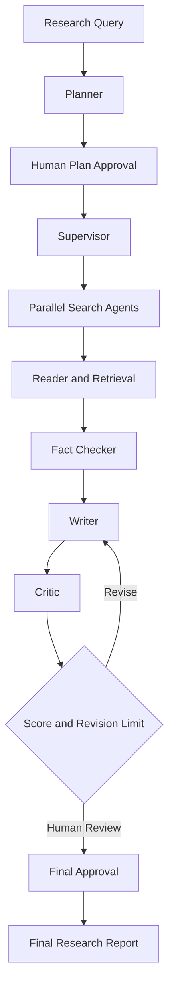

# Multi-Agent Research Analyst

A production-oriented research automation system built using LangChain,
LangGraph, Gemini, Exa, Qdrant, FastAPI, PostgreSQL, Redis, and Streamlit.

## Project Objective

Build an intelligent research analyst that autonomously plans research,
searches multiple sources, extracts evidence, performs retrieval,
generates grounded reports, verifies claims, evaluates quality,
and requests human approval.

## Current Implementation Status

### Phase 1: Foundation and Architecture

- [x] Project structure
- [x] Centralized configuration
- [x] Gemini provider factory
- [x] Pydantic agent contracts
- [x] Typed ResearchState
- [x] Initial LangGraph workflow
- [x] Basic unit tests written

### Upcoming Phases

- [ ] Phase 2: Agentic workflow and HITL
- [ ] Phase 3: Search, scraping, RAG and citations
- [ ] Phase 4: Evaluation framework
- [ ] Phase 5: FastAPI, database and Streamlit
- [ ] Phase 6: Observability and deployment

## Architecture



## Technology Stack

- Python 3.11+
- LangChain
- LangGraph
- Pydantic
- Google Gemini
- Exa
- Qdrant
- FastAPI
- PostgreSQL
- Redis
- Streamlit
- Ragas
- Docker

## Local Setup

Create a virtual environment:

```powershell
py -3.11 -m venv .venv
.\.venv\Scripts\Activate.ps1
pip install -r requirements.txt
```

Copy `.env.example` to `.env` and configure Gemini credentials.

## Run Tests

```powershell
python -m pytest
```

## Current Limitations

Phase 1 establishes the architecture and interfaces only.
Live agent execution, external search, RAG, persistence, and UI
will be implemented in their respective phases.

No live API calls or end-to-end research execution are claimed yet.
