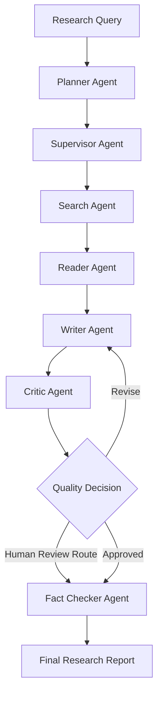

# Multi-Agent Research Analyst

An intelligent, multi-agent research system designed to automate complex research tasks through specialized AI agents, evidence-grounded report generation, quality evaluation, and citation verification.

The project follows a modular, multi-phase architecture using Python, Pydantic, LangGraph, Gemini, and Exa.

> **Project Status:** Active Development  
> **Current Focus:** Agentic Workflow Implementation and Integration

---

## Table of Contents

- [Overview](#overview)
- [Project Objectives](#project-objectives)
- [Key Features](#key-features)
- [System Architecture](#system-architecture)
- [Agent Responsibilities](#agent-responsibilities)
- [Research Workflow](#research-workflow)
- [Technology Stack](#technology-stack)
- [Project Structure](#project-structure)
- [Implementation Roadmap](#implementation-roadmap)
- [Installation and Setup](#installation-and-setup)
- [Environment Configuration](#environment-configuration)
- [Running the Project](#running-the-project)
- [Testing](#testing)
- [Current Limitations](#current-limitations)
- [Future Improvements](#future-improvements)

---

## Overview

Multi-Agent Research Analyst is a modular AI-powered research automation project that aims to transform complex research queries into structured, evidence-supported research reports.

Instead of relying on a single LLM call, the system uses specialized agents, each responsible for a specific part of the research process.

The intended workflow includes:

1. Understanding and planning the research query.
2. Coordinating specialized research agents.
3. Gathering information from external sources.
4. Extracting and processing relevant content.
5. Generating a structured research report.
6. Evaluating report quality.
7. Verifying claims and citations.
8. Routing reports for revision or human review.

The long-term goal is to build a reliable research platform with hybrid retrieval, evaluation pipelines, a backend API, and an interactive frontend.

## Project Objectives

- Build a modular multi-agent architecture.
- Separate agent responsibilities through well-defined interfaces.
- Use structured Pydantic contracts for reliable data exchange.
- Orchestrate agent execution using LangGraph.
- Generate evidence-grounded research reports.
- Evaluate report quality through a Critic Agent.
- Verify claims and citations through a Fact Checker Agent.
- Integrate external search and LLM providers.
- Gradually extend the system into a production-ready research application.

## Key Features

### Implemented

- Modular Python project architecture.
- Configuration and environment variable management.
- Pydantic-based request, response, and state contracts.
- Base agent interface.
- Planner Agent.
- Supervisor Agent.
- Search Agent and Exa provider integration.
- Reader Agent and web content extraction.
- Writer Agent for structured research reports.
- Critic Agent for report quality evaluation.
- Fact Checker Agent for claim and citation verification.
- LangGraph workflow orchestration.
- Conditional routing and bounded revision loop.
- Automated unit and integration tests.

### Planned

- Parallel research workers and advanced orchestration.
- Human approval interface.
- Qdrant-based vector storage.
- BM25 and hybrid retrieval.
- Embedding-based semantic search.
- Reranking and advanced citation grounding.
- Ragas and custom evaluation benchmarks.
- FastAPI backend and Streamlit frontend.
- PostgreSQL, Redis, and Celery integration.
- Docker-based deployment and CI/CD.

---

## System Architecture

The system is designed around specialized agents connected through a shared, typed workflow state.

### High-Level Architecture



*Note: This diagram represents the intended high-level flow. Actual workflow routing and approval behavior are governed by the current LangGraph implementation. A dedicated human approval interface is not yet implemented.*

### Architectural Principles

- **Modularity:** Each agent has a clearly defined responsibility.
- **Separation of Concerns:** Search, reading, writing, critique, and verification are independent components.
- **Structured Communication:** Pydantic models define agent input and output contracts.
- **Workflow Orchestration:** LangGraph manages execution and conditional routing.
- **Extensibility:** New retrieval, evaluation, and application components can be added without redesigning the entire system.

---

## Agent Responsibilities

| Agent | Responsibility |
|---|---|
| Planner Agent | Structures the research task and planning requirements. |
| Supervisor Agent | Coordinates research execution and agent workflow. |
| Search Agent | Retrieves relevant external information. |
| Reader Agent | Fetches and extracts content from web sources. |
| Writer Agent | Generates structured research reports grounded in available evidence. |
| Critic Agent | Evaluates report quality and provides revision feedback. |
| Fact Checker Agent | Checks claims, citations, and potential contradictions. |

### Agent Communication

Agents communicate through structured contracts defined using Pydantic.

The base agent interface establishes a consistent pattern for agent execution and typed inputs and outputs.

---

## Research Workflow

The current workflow is orchestrated using LangGraph.

### Workflow Stages

1. **Initialization:** Validate the research query and initialize workflow metadata.
2. **Planning and Coordination:** Prepare the research task and coordinate execution.
3. **Research:** Retrieve relevant information using search components.
4. **Reading:** Fetch and extract content from selected sources.
5. **Writing:** Generate a structured research report.
6. **Critique:** Evaluate the report and generate quality feedback.
7. **Conditional Routing:** Route the report for revision or onward verification.
8. **Fact Checking:** Verify claims and citation-related information.
9. **Completion:** Return the resulting research workflow output.

The workflow includes a bounded revision loop to prevent indefinite regeneration. The current revision limit is three.

---

## Technology Stack

| Category | Technology |
|---|---|
| Language | Python |
| Data Validation | Pydantic |
| Workflow Orchestration | LangGraph |
| LLM Provider | Google Gemini |
| Search Provider | Exa |
| Testing | Pytest |
| Code Quality | Ruff |
| Configuration | Environment Variables |
| Version Control | Git and GitHub |

Additional technologies such as Qdrant, PostgreSQL, Redis, Celery, FastAPI, Streamlit, Ragas, and Docker are planned for later phases.

---

## Project Structure

```text
MultiAgent-Research-Analyst/
│
├── agents/
│   ├── __init__.py
│   ├── base.py
│   ├── contracts.py
│   ├── planner.py
│   ├── supervisor.py
│   ├── search_agent.py
│   ├── reader_agent.py
│   ├── writer.py
│   ├── critic.py
│   └── fact_checker.py
│
├── app/
│   ├── __init__.py
│   ├── backend/
│   │   ├── routes/
│   │   ├── schemas/
│   │   └── services/
│   └── frontend/
│       ├── components/
│       └── utils/
│
├── database/
│   └── __init__.py
│
├── evaluation/
│   └── __init__.py
│
├── graph/
│   ├── __init__.py
│   ├── nodes.py
│   ├── nodes.py.backup
│   ├── routing.py
│   ├── state.py
│   └── workflow.py
│
├── llm/
│   ├── __init__.py
│   └── gemini.py
│
├── observability/
│   └── __init__.py
│
├── reader/
│   ├── __init__.py
│   ├── content_extractor.py
│   └── web_fetcher.py
│
├── retrieval/
│   └── __init__.py
│
├── search/
│   ├── __init__.py
│   ├── exa_provider.py
│   └── workers.py
│
├── tests/
│   ├── __init__.py
│   ├── test_contracts.py
│   ├── test_critic.py
│   ├── test_fact_checker.py
│   ├── test_graph.py
│   ├── test_planner.py
│   ├── test_reader.py
│   ├── test_routing.py
│   ├── test_search.py
│   ├── test_supervisor.py
│   └── test_writer.py
│
├── .env.example
├── .gitignore
├── config.py
├── pyproject.toml
├── requirements.txt
└── README.md
```

### Directory and File Responsibilities

#### `agents/` — Agent Implementations

Contains specialized agents and their communication contracts.

| File | Purpose |
|---|---|
| `base.py` | Defines the common base agent interface. |
| `contracts.py` | Defines structured Pydantic request and response models. |
| `planner.py` | Research task planning. |
| `supervisor.py` | Agent coordination and supervision. |
| `search_agent.py` | Search agent implementation. |
| `reader_agent.py` | Reader agent implementation. |
| `writer.py` | Research report generation. |
| `critic.py` | Report quality evaluation and feedback. |
| `fact_checker.py` | Claim and citation verification. |

#### `graph/` — Workflow Orchestration

Contains the LangGraph workflow implementation.

| File | Purpose |
|---|---|
| `state.py` | Defines shared research workflow state. |
| `nodes.py` | Implements workflow node functions and agent integration. |
| `routing.py` | Defines conditional workflow routing. |
| `workflow.py` | Builds and connects the LangGraph workflow. |
| `nodes.py.backup` | Backup copy of an earlier nodes implementation; not part of the active workflow. |

#### `search/` — Search Infrastructure

| File | Purpose |
|---|---|
| `exa_provider.py` | Exa search provider integration. |
| `workers.py` | Search worker functionality. |

#### `reader/` — Web Content Processing

| File | Purpose |
|---|---|
| `web_fetcher.py` | Fetches web content. |
| `content_extractor.py` | Extracts readable content from fetched pages. |

#### `llm/` — LLM Integration

| File | Purpose |
|---|---|
| `gemini.py` | Google Gemini integration. |

#### `app/` — Application Layer

Reserved for the future application interface.

- `backend/routes/` — API route layer.
- `backend/schemas/` — API-specific schemas.
- `backend/services/` — Backend service logic.
- `frontend/components/` — Frontend components.
- `frontend/utils/` — Frontend utilities.

These folders currently contain package initialization files and are not yet a completed application.

#### `database/`

Reserved for database integration and persistence.

#### `retrieval/`

Reserved for retrieval pipelines such as embeddings, vector search, BM25, hybrid retrieval, and reranking.

#### `evaluation/`

Reserved for evaluation pipelines, benchmarks, and research quality metrics.

#### `observability/`

Reserved for logging, tracing, monitoring, and LangSmith integration.

#### `tests/` — Automated Testing

Contains tests for contracts, agents, search, routing, and workflow integration.

#### Root Configuration Files

| File | Purpose |
|---|---|
| `config.py` | Central project configuration. |
| `pyproject.toml` | Project tooling and configuration. |
| `requirements.txt` | Python dependencies. |
| `.env.example` | Example environment variable configuration. |
| `.gitignore` | Excludes virtual environments, secrets, caches, and generated files. |
| `README.md` | Project documentation. |

---

## Implementation Roadmap

The project is being developed in six phases.

### Phase 1 — Foundation

**Status: Completed**

- Project structure.
- Configuration management.
- Pydantic schemas and contracts.
- State management.
- Base agent interfaces.
- Initial automated tests.

### Phase 2 — Agentic Workflow

**Status: Partially Completed**

- Planner Agent.
- Supervisor Agent.
- Search and Reader agents.
- Writer Agent.
- Critic Agent.
- Fact Checker Agent.
- LangGraph orchestration.
- Conditional routing.
- Bounded revision loop.

**Remaining:**
- Parallel research worker orchestration and validation.
- Actual human approval mechanism.

### Phase 3 — Research and RAG

**Status: In Progress / Planned**

- Exa integration.
- Web scraping and content extraction.
- Embedding generation.
- Qdrant vector database.
- BM25 retrieval.
- Hybrid retrieval.
- Reranking.
- Grounded citation pipeline.

Existing Exa and web-reading components provide the initial research infrastructure. The complete RAG pipeline remains to be implemented.

### Phase 4 — Evaluation

**Status: Planned**

- Ragas integration.
- Custom research benchmarks.
- Faithfulness evaluation.
- Retrieval quality evaluation.
- Citation evaluation.

### Phase 5 — Application

**Status: Planned**

- FastAPI backend.
- PostgreSQL persistence.
- Redis integration.
- Celery task processing.
- Streamlit frontend.

### Phase 6 — Production Readiness

**Status: Planned**

- Structured logging.
- LangSmith tracing and observability.
- Docker containerization.
- CI/CD pipeline.
- Security improvements.
- Production-level testing.

---

## Installation and Setup

### 1. Clone the Repository

```bash
git clone https://github.com/aishwaryaverma05/MultiAgent-Research-Analyst.git

cd MultiAgent-Research-Analyst
```

### 2. Create a Virtual Environment

Windows:

```powershell
python -m venv .venv
.venv\Scripts\Activate.ps1
```

Linux/macOS:

```bash
python -m venv .venv
source .venv/bin/activate
```

### 3. Install Dependencies

```bash
pip install -r requirements.txt
```

### 4. Configure Environment Variables

Create a `.env` file using the example configuration:

```powershell
Copy-Item .env.example .env
```

Add the required API credentials to `.env`.

Never commit your actual `.env` file or API keys to GitHub.

---

## Environment Configuration

The project uses environment-based configuration.

Refer to `.env.example` for the exact variable names required by the current implementation.

Typical integrations include:

- Google Gemini API credentials.
- Exa API credentials.

The exact required variables should be checked against the current configuration and provider implementation.

---

## Running the Project

The workflow and agent components are currently being developed and validated as a Python application.

The exact execution entry point and runtime configuration should be followed from the current application implementation.

The future application phase will provide a dedicated API and frontend interface.

---

## Testing

The project uses Pytest for automated testing and Ruff for linting.

Run the complete test suite:

```bash
python -m pytest -q
```

Run code quality checks:

```bash
ruff check .
```

### Current Validation Results

| Validation | Result |
|---|---|
| Automated test suite | 46 passed |
| Ruff lint checks | All checks passed |
| LangGraph integration tests | 4 passed |

The LangGraph integration tests use test doubles/fake agents to validate workflow behavior. Full live execution using real external API providers remains a separate validation task.

---

## Current Limitations

- Complete RAG infrastructure is not yet implemented.
- Vector database and hybrid retrieval are planned.
- Dedicated human approval interface is not implemented.
- Evaluation benchmarks are pending.
- FastAPI and frontend application are pending.
- Production observability and deployment infrastructure are pending.
- Full live API-based workflow execution still needs validation.

---

## Future Improvements

The next development milestones include:

1. Validate the complete workflow using real Gemini and Exa API calls.
2. Complete parallel research worker orchestration.
3. Implement human approval and review.
4. Build the RAG pipeline using embeddings and Qdrant.
5. Add hybrid retrieval and reranking.
6. Integrate Ragas and custom evaluation metrics.
7. Develop the FastAPI and Streamlit application.
8. Add persistence, background task processing, and observability.
9. Containerize and prepare the application for deployment.

---

## Project Repository

GitHub: https://github.com/aishwaryaverma05/MultiAgent-Research-Analyst

---

**Built as an ongoing exploration of multi-agent systems, LLM orchestration, research automation, and production-oriented AI engineering.**
